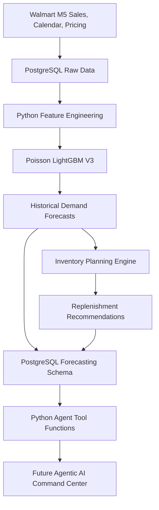

# System Architecture

## Current Implementation
The forecasting and inventory modules are implemented.
The final multi-agent orchestration is future work.

## Operational Data
Inventory and supplier inputs are simulated for demonstration.

## Decision Policy
Periodic-review inventory planning using an assumed demand
uncertainty model and an order-up-to replenishment target.
